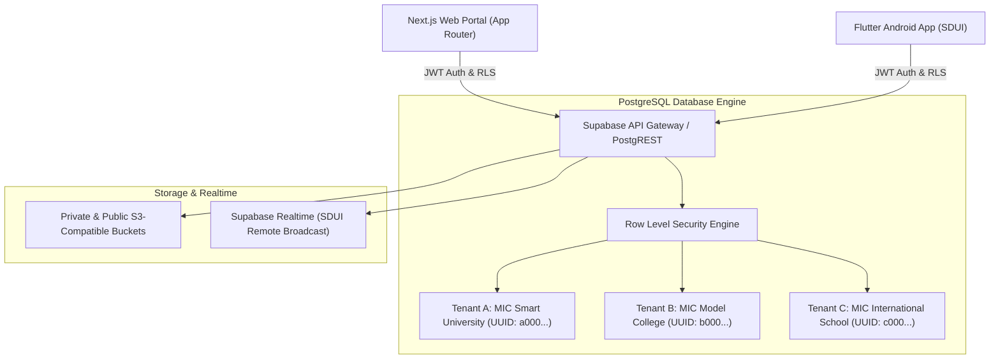
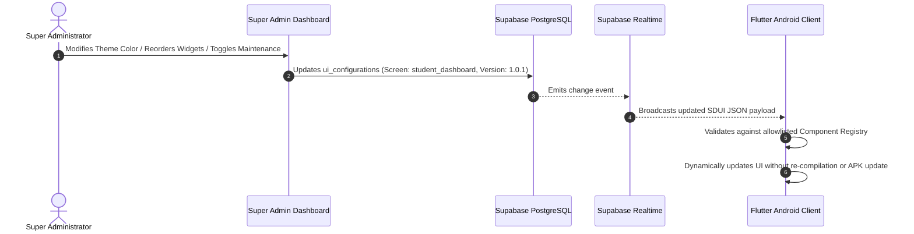

# MIC SMART CAMPUS — SYSTEM ARCHITECTURE SPECIFICATION

## 1. Executive Summary

**MIC Smart Campus** is an enterprise-grade Multi-Tenant Academic Management & Smart Campus Platform designed for educational institutions across Bangladesh (schools, colleges, and universities). The platform delivers a unified web portal for platform super administrators, institution administrators, educators, students, and guardians, combined with a native Flutter Android mobile app empowered by Server-Driven UI (SDUI).

---

## 2. Multi-Tenant Isolation Architecture

### PostgreSQL Row Level Security (RLS)
Tenant isolation is enforced strictly at the database kernel level:
- Every tenant-owned table features an immutable `institution_id UUID REFERENCES institutions(id)`.
- Default-deny policies are applied across all tables.
- RLS helper function `get_user_institution_ids(auth.uid())` validates active membership.
- Cross-tenant queries are blocked by the database engine regardless of client-side modifications.

---

## 3. Server-Driven UI (SDUI) Remote Control Architecture

### Allowlisted Component Registry:
To prevent remote code execution or injection vulnerabilities, SDUI supports ONLY strictly allowlisted component identifiers:
1. `announcement_bar`
2. `stats_card`
3. `quick_actions_grid`
4. `attendance_summary`
5. `fee_due_card`
6. `routine_timeline`
7. `recent_notices`
8. `upcoming_exams`
9. `recent_results`

Arbitrary scripts, unverified JavaScript, or dynamic code execution are forbidden by design.

---

## 4. Role-Based Access Control (RBAC) Matrix

| Role | Scope | Key Capabilities & Boundaries |
| :--- | :--- | :--- |
| **Super Admin** | Platform | Global multi-tenant provisioning, subscription plans, system health, audit logs, and remote SDUI control. |
| **Institution Owner / Admin** | Institution | Complete institutional management: classes, sections, teacher assignments, student rosters, fees, and notices. |
| **Principal / Vice Principal** | Institution | Academic oversight, examination approvals, routine reviews, and institutional reporting. |
| **Teacher / Faculty** | Institution | Daily class attendance marking, examination mark entry, routine viewing, and notice creation. |
| **Student** | Institution (Self) | Restricted to viewing own attendance %, examination results, class routine, fee invoices, and notices. |
| **Parent / Guardian** | Institution (Linked) | Restricted strictly to viewing verified linked children's attendance, GPA cards, and fee invoices. |

---

## 5. Technology Stack Summary

- **Web Frontend**: Next.js 14 App Router, TypeScript, Tailwind CSS, Lucide Icons, Recharts.
- **Mobile Frontend**: Flutter 3.50+, Dart 3.14+, Material 3, Riverpod, GoRouter, Supabase Flutter SDK.
- **Backend & Database**: Centralized Supabase PostgreSQL 15+, Row Level Security, Realtime, Storage Buckets.
- **Localization**: BDT (৳) Currency, Asia/Dhaka Timezone, DD-MM-YYYY Date Formats, English and Bengali support.
