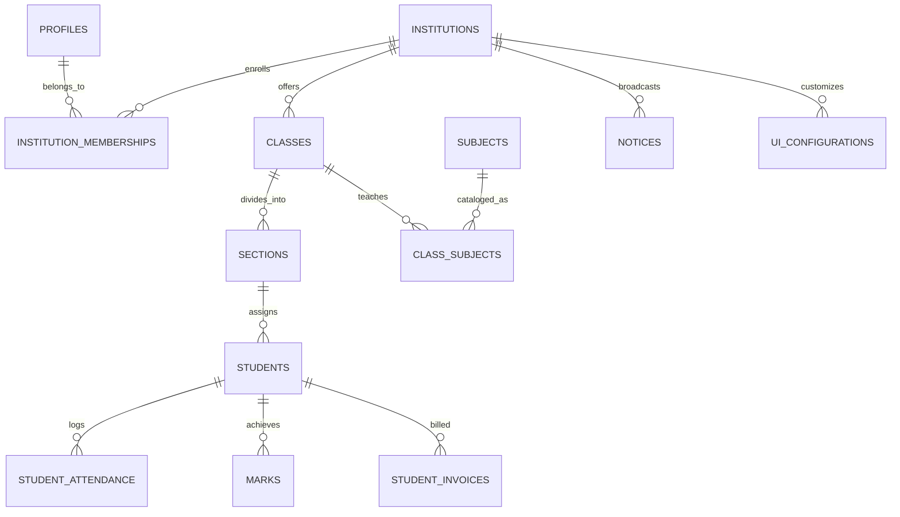

# MIC SMART CAMPUS — DATABASE SCHEMA & DATA DICTIONARY

## 1. Overview
The database layer for MIC Smart Campus is deployed on PostgreSQL 15+ hosted via Supabase. It uses strict relational foreign key constraints, Row Level Security (RLS) on all private tables, and automated audit triggers.

---

## 2. Entity-Relationship Model



---

## 3. Data Dictionary

### 3.1. Identity & Tenancy

| Table Name | Primary Key | Description | Key Foreign Keys |
| :--- | :--- | :--- | :--- |
| `profiles` | `id UUID` | User identity linked to `auth.users` | `id -> auth.users(id)` |
| `institutions` | `id UUID` | Institutional tenant record | Unique `code` |
| `institution_memberships` | `id UUID` | Links user to institution with status | `institution_id`, `user_id` |
| `roles` | `id UUID` | System and custom roles | Scope: `platform` or `institution` |
| `permissions` | `id UUID` | Granular permission registry | Unique `code` |
| `membership_roles` | Composite | Role assignment per membership | `membership_id`, `role_id` |

### 3.2. Academic Management

| Table Name | Primary Key | Description | Key Columns |
| :--- | :--- | :--- | :--- |
| `academic_sessions` | `id UUID` | Academic years (e.g. 2026-2027) | `start_date`, `end_date`, `is_current` |
| `classes` | `id UUID` | Grades / Year batches | `name`, `code`, `numeric_level` |
| `sections` | `id UUID` | Class sections (e.g. Section A) | `class_id`, `capacity`, `room_number` |
| `subjects` | `id UUID` | Course subjects | `code`, `credit_hours`, `is_optional` |
| `class_routines` | `id UUID` | Weekly schedule per period | `day_of_week`, `start_time`, `end_time` |

### 3.3. Students & Guardians

| Table Name | Primary Key | Description | Key Columns |
| :--- | :--- | :--- | :--- |
| `students` | `id UUID` | Enrolled student record | `student_id_code`, `class_id`, `blood_group` |
| `guardians` | `id UUID` | Parent / Guardian info | `phone`, `relationship`, `user_id` |
| `student_guardians` | Composite | Student-to-guardian mapping | `is_primary`, `can_pickup` |

### 3.4. Attendance & Examination

| Table Name | Primary Key | Description | Key Columns |
| :--- | :--- | :--- | :--- |
| `student_attendance` | `id UUID` | Daily attendance per student | `attendance_date`, `status` (present, absent) |
| `examinations` | `id UUID` | Scheduled examination sessions | `exam_type`, `start_date`, `is_published` |
| `marks` | `id UUID` | Marks obtained per subject | `marks_obtained`, `max_marks`, `grade` |
| `published_results` | `id UUID` | Final report card and GPA | `total_marks`, `gpa`, `final_grade` |

### 3.5. Finance & Invoicing

| Table Name | Primary Key | Description | Key Columns |
| :--- | :--- | :--- | :--- |
| `fee_structures` | `id UUID` | Standard fees per class/session | `amount`, `due_date`, `category_id` |
| `student_invoices` | `id UUID` | Invoices issued to students | `total_amount`, `paid_amount`, `due_amount` |
| `payments` | `id UUID` | Payment transactions | `amount`, `payment_method`, `transaction_id` |

### 3.6. Server-Driven UI (SDUI)

| Table Name | Primary Key | Description | Key Columns |
| :--- | :--- | :--- | :--- |
| `ui_configurations` | `id UUID` | Live mobile app configurations | `screen_id`, `version`, `config_data (jsonb)` |
| `ui_configuration_versions` | `id UUID` | Historical configuration rollback | `version_number`, `config_data`, `created_at` |
| `ui_publications` | `id UUID` | Active broadcast pointer | `active_version_id`, `published_at` |

---

## 4. PostgreSQL Indexes for Tenancy Performance

```sql
CREATE INDEX idx_memberships_user ON public.institution_memberships(user_id);
CREATE INDEX idx_memberships_inst ON public.institution_memberships(institution_id);
CREATE INDEX idx_students_inst ON public.students(institution_id);
CREATE INDEX idx_attendance_student_date ON public.student_attendance(student_id, attendance_date);
CREATE INDEX idx_invoices_student ON public.student_invoices(student_id);
CREATE INDEX idx_audit_logs_inst ON public.audit_logs(institution_id);
```
